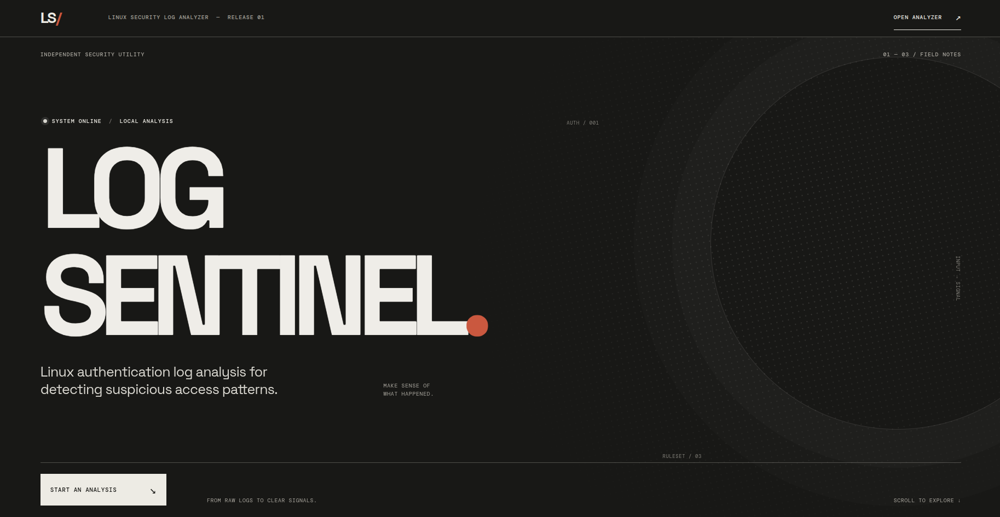
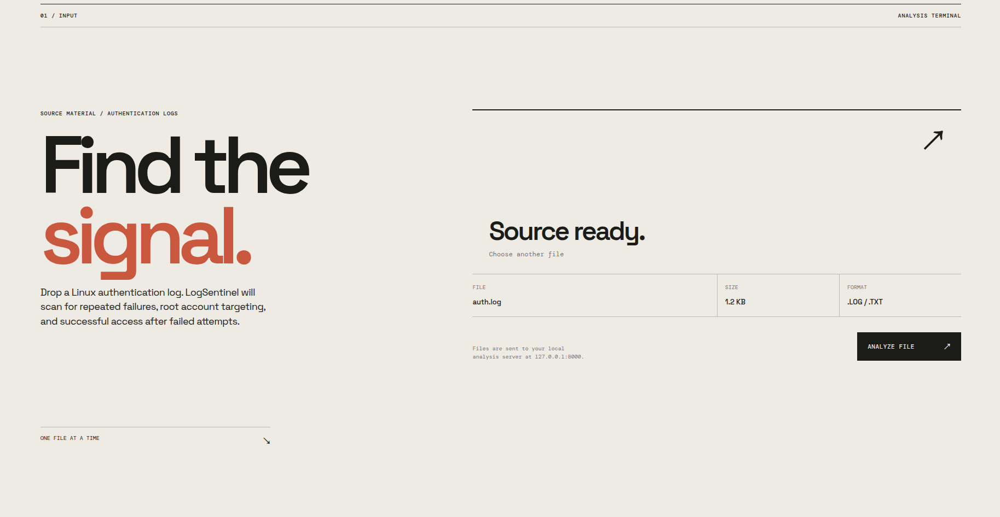

# LogSentinel

LogSentinel is a full-stack cybersecurity project designed to analyze Linux authentication logs and detect suspicious access patterns.

The application processes `.log` and `.txt` files, extracts authentication events and generates security alerts based on predefined detection rules. The project was built as a hands-on way to study Python, Linux logs, cybersecurity detection logic, APIs and frontend/backend integration.

---

## Overview

Linux systems generate authentication logs containing information about successful and failed login attempts.

LogSentinel analyzes these events and identifies suspicious patterns such as:

- repeated failed login attempts;
- possible brute-force attacks;
- repeated attempts against the `root` account;
- successful authentication after multiple failed attempts.

The backend performs the security analysis and returns structured results through a REST API. The React frontend allows users to upload a log file and visualize the detected events and alerts.

---

## Screenshots

### Dashboard



### File Upload



### Security Alerts


---

## Features

### Brute Force Detection

LogSentinel groups failed login attempts by IP address and analyzes them using a sliding time window.

By default, the system considers the following behavior suspicious:

```text
5 or more failed attempts
within 60 seconds
```

The detector continues analyzing the complete sequence so it can identify the largest suspicious group within the configured time window.

Example:

```text
IP: 192.0.2.10
Attempts: 6
Time window: 14 seconds
```

---

### Root Account Targeting

The system identifies 3 or more failed authentication attempts directed at the Linux `root` account from the same IP within 60 seconds.

Example:

```text
Type: root_attack
IP: 192.0.2.10
User: root
Attempts: 6
Severity: high
```

---

### Successful Login After Repeated Failures

LogSentinel detects 3 or more failed attempts followed by a successful login within 60 seconds, for the same IP and user.

Example:

```text
Type: success_after_failures
IP: 203.0.113.25
User: analyst
Previous failed attempts: 3
Severity: critical
```

This type of event may deserve additional investigation because repeated failures followed by a successful authentication can represent suspicious access behavior.

---

## Alert Severity

Alerts are classified according to their detection type.

```text
HIGH
- Brute force activity
- Root account targeting

CRITICAL
- Successful login after repeated failures
```

The API also returns a summary containing the number of alerts by severity.

---

## Architecture

```text
                Log file
                   │
                   ▼
              React Frontend
                   │
                   │ POST /analyze
                   ▼
               FastAPI
                   │
                   ▼
              Log Parser
                   │
                   ▼
          Authentication Events
                   │
                   ▼
            Detection Engine
                   │
         ┌─────────┼─────────┐
         ▼         ▼         ▼
     Brute      Root      Successful
     Force      Attack     After Failures
         │         │         │
         └─────────┼─────────┘
                   ▼
                Alerts
                   │
                   ▼
              JSON Response
                   │
                   ▼
            React Dashboard
```

---

## Project Structure

```text
logsentinel/
│
├── backend/
│   ├── __init__.py
│   ├── api.py
│   ├── detector.py
│   ├── main.py
│   └── parser.py
│
├── frontend/
│   ├── src/
│   ├── package.json
│   └── ...
│
├── samples/
│   ├── auth.log
│   └── auth_test_2.log
│
├── tests/
│   └── test_detector.py
│
├── .gitignore
├── requirements.txt
└── README.md
```

---

## Technologies

### Backend

- Python
- FastAPI
- Regular Expressions
- datetime
- python-multipart

### Frontend

- React
- Vite
- JavaScript
- CSS
- ESLint

### Testing

- pytest

### Environment

- Linux
- Git
- GitHub

---

## API

The backend exposes the following main endpoint:

```text
POST /analyze
```

The request must contain a `.log` or `.txt` file using the field:

```text
file
```

Example response:

```json
{
  "file": {
    "name": "auth_test_2.log",
    "events_found": 12
  },
  "summary": {
    "alerts_found": 3,
    "severity": {
      "medium": 0,
      "high": 2,
      "critical": 1
    }
  },
  "alerts": [
    {
      "type": "brute_force",
      "severity": "high",
      "ip": "192.0.2.50",
      "attempts": 5,
      "time_window": 32
    },
    {
      "type": "root_attack",
      "severity": "high",
      "ip": "192.0.2.50",
      "attempts": 5,
      "user": "root"
    },
    {
      "type": "success_after_failures",
      "severity": "critical",
      "ip": "203.0.113.25",
      "failed_attempts": 3,
      "user": "analyst",
      "timestamp": "2026-09-29T20:20:20"
    }
  ]
}
```

---

## Running the Project

### 1. Clone the repository

```bash
git clone <repository-url>
cd logsentinel
```

---

### 2. Create the Python virtual environment

```bash
python3 -m venv .venv
```

Activate it:

```bash
source .venv/bin/activate
```

---

### 3. Install backend dependencies

```bash
pip install -r requirements.txt
```

---

### 4. Start the FastAPI backend

From the project root:

```bash
fastapi dev backend/api.py
```

The API should be available at:

```text
http://127.0.0.1:8000
```

Interactive API documentation:

```text
http://127.0.0.1:8000/docs
```

---

### 5. Install frontend dependencies

Open another terminal:

```bash
cd frontend
npm install
```

---

### 6. Start the frontend

```bash
npm run dev
```

Keep the backend running in the first terminal. The Vite development server forwards `/api` requests to the backend on `127.0.0.1:8000`. The frontend will normally be available at:

```text
http://localhost:5173
```

---

## Command-Line Analysis

The backend can also analyze a log file directly from the terminal.

From the project root:

```bash
python3 -m backend.main samples/auth.log
```

Example output:

```text
[ALERT] Possible brute-force attack
IP: 192.0.2.10
Failed attempts: 6
Time window: 14.0 seconds
```

---

## Running Tests

Activate the Python virtual environment:

```bash
source .venv/bin/activate
```

Then run:

```bash
python -m pytest
```

Current detector tests cover:

- brute-force detection;
- normal behavior without brute-force alert;
- root account targeting;
- successful authentication after repeated failures.

Expected result:

```text
8 passed
```

---

## Frontend Lint

To validate the frontend code:

```bash
cd frontend
npm run lint
```

---

## Sample Logs

The files inside `samples/` contain fictional authentication data created only for testing.

The IP addresses used in the examples belong to ranges reserved for documentation and testing purposes.

No real authentication logs are required to run the project.

---

## What I Learned

This project was developed as a practical cybersecurity learning project.

Some of the concepts explored include:

- Linux authentication logs;
- SSH authentication events;
- parsing structured and semi-structured logs;
- regular expressions;
- IP-based event grouping;
- time-window analysis;
- sliding-window algorithms;
- brute-force detection;
- security alert classification;
- Python dictionaries and lists;
- REST APIs with FastAPI;
- file uploads;
- JSON responses;
- React and backend integration;
- automated testing with pytest;
- frontend linting with ESLint.

---

## Future Improvements

Possible future improvements include:

- additional SSH attack detection rules;
- configurable detection thresholds;
- persistent event storage;
- historical analysis;
- IP reputation integration;
- geographic visualization;
- authentication timeline visualization;
- more advanced detection techniques;
- exportable incident reports;
- Docker support;
- automated CI tests with GitHub Actions.

---

## Supported logs and limitations

- The parser recognizes SSH `Failed password` and `Accepted password` events, including IPv4 and IPv6. Other events and malformed lines are ignored. A result with zero recognized events does not mean the log is safe.
- Traditional dates such as `Dec 31 23:59:59` have no year. The last traditional date is assigned the current year; earlier December-to-January crossings are adjusted assuming the file is in chronological order. The real year of an old log cannot be determined from those dates alone. Use logs with explicit years when the actual year matters.
- Each upload is limited to 10 MB. The frontend proxy is for the Vite development server; a deployed frontend needs a server or proxy configured to forward `/api` to the backend.
- Thresholds are simplified educational rules. A single IP may represent multiple people, and alerts require investigation.

---

## Disclaimer

LogSentinel is an educational cybersecurity project.

The current detection rules are simplified and are intended for learning and demonstration purposes. Alerts generated by the application should not be considered definitive evidence of malicious activity without additional investigation.

---

## Author

**Amanda Silva da Mata**

Software Engineering student interested in Cybersecurity, AI Security, offensive security and secure software development.

GitHub: `github.com/amandasilvamata`